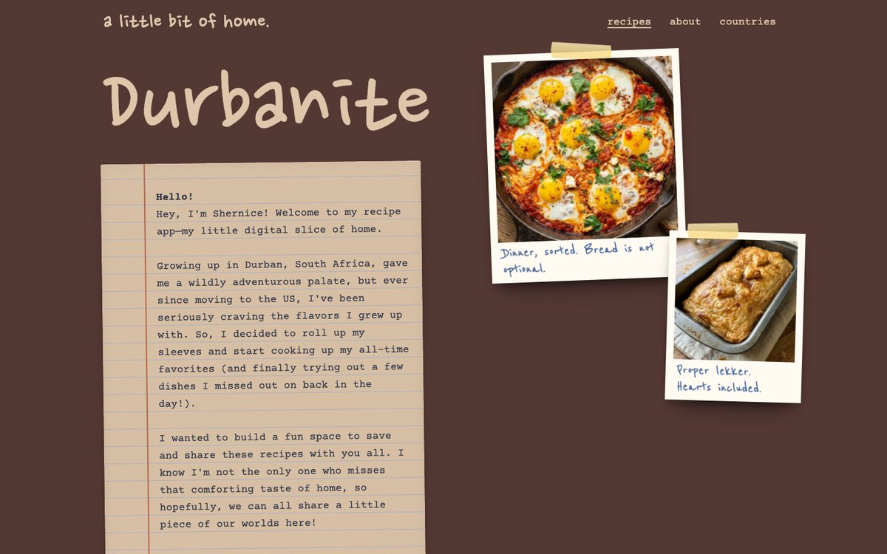
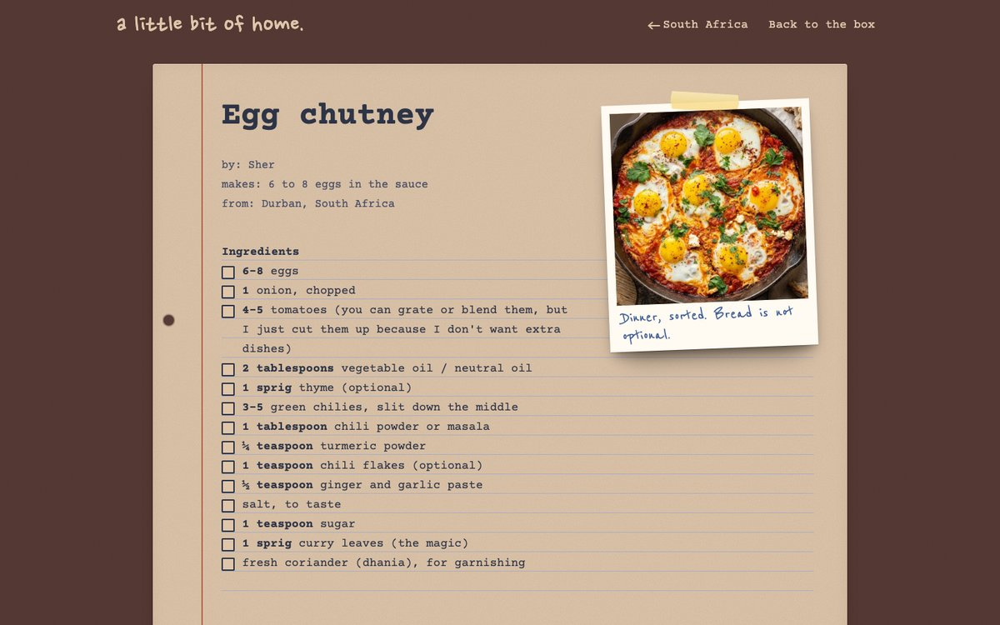
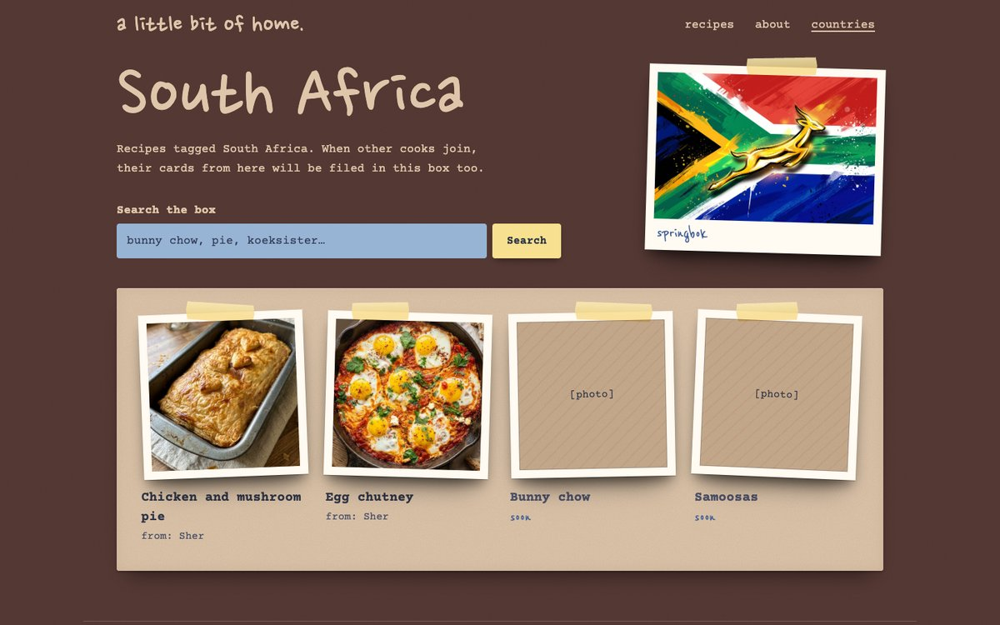
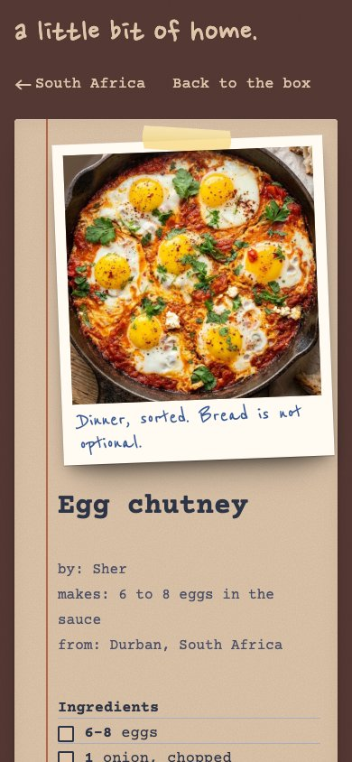

# a little bit of home

A personal recipe site for the dishes I grew up on in Durban, South Africa. It is built to grow into a community where people add recipes from their own countries.

Live demo: _add link here once deployed_



| Recipe page | Country page |
| --- | --- |
|  |  |



## What it does

- **Recipe pages** with ingredients you can tick off, and a method broken into steps where every action has its own tick box. Ticks are remembered in the browser.
- **Search and category filters** on the home page and on each country page, filtering as you type.
- **Country pages** that list recipes by country, ready for recipes from other cooks.
- **Content-driven:** each recipe is a JSON file, so adding one never means touching layout code.
- **Photos** drop in by filename, with no code change.
- **Accessible and responsive:** works on a phone, visible keyboard focus, respects reduced motion, and readable contrast.

## Tech

- Node.js (18+) with no dependencies and no build step, so there is nothing to install and nothing to audit.
- Server-rendered HTML from plain template functions, with a small amount of vanilla JavaScript for search, filters and ticks.
- Hand-written CSS using a 28px ruled-paper grid, with fonts self-hosted.
- Hardened static server: strict Content-Security-Policy and other security headers, GET and HEAD only, dotfiles never served, path-traversal tested, and all content escaped.

## Run it

```
npm start
```

Then open http://localhost:3000. Use `PORT=4000 npm start` to change the port.

## Project layout

```
content/recipes/*.json   one file per recipe
content/site.json        site text and category tabs
lib/                     templates, content loader, illustrations
public/                  CSS, JS, fonts, images
server.js                routing and security headers
DESIGN.md                the design system and the reasons behind it
```

## Roadmap

- Accounts and recipe submissions tagged by country
- Cook-along videos
- Chat-based recipe adding

## Notes

Built with Claude Code. The design reasoning is in [DESIGN.md](DESIGN.md).
